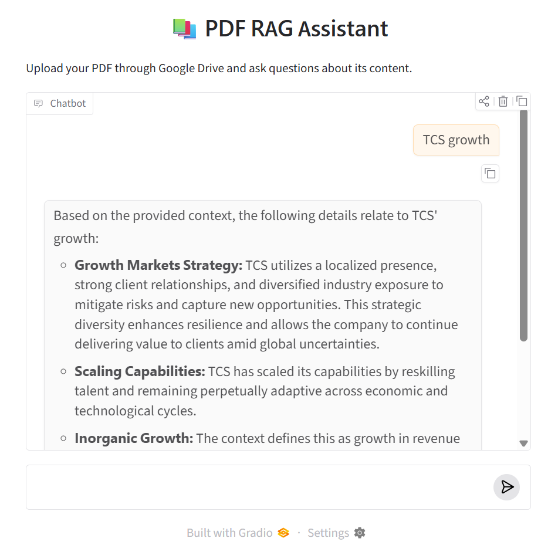

# PDF-Based Retrieval-Augmented Generation (RAG) with Front-End

## Project Overview
This project implements a Retrieval-Augmented Generation (RAG) system that allows users to upload PDF documents and ask questions based on their content. The system retrieves relevant information from the uploaded documents and generates accurate, context-based answers using a Large Language Model (LLM).

## Features
- Upload PDF documents.
- Extract and process PDF text.
- Split documents into smaller text chunks.
- Generate text embeddings.
- Store embeddings using FAISS vector database.
- Retrieve relevant document content based on user queries.
- Generate answers using Google Gemini.
- Interactive Gradio front-end.

## Technologies Used
- Python
- Google Colab
- Hugging Face Embeddings
- FAISS
- Google Gemini API
- Gradio
- LangChain

## Project Workflow
PDF Upload → Text Extraction → Text Splitting → Embedding Generation → FAISS Vector Storage → Similarity Search → Gemini LLM → Answer Generation

## How to Run
1. Open the notebook in Google Colab.
2. Run the installation and setup cells.
3. Upload a PDF document.
4. Enter your Gemini API key when prompted.
5. Process the document.
6. Ask questions and receive answers based on the PDF content.

## Project Type
Artificial Intelligence | Natural Language Processing | Generative AI | RAG

## Author
Dedeepya Siri Aalugubelli

## Application Screenshot

### PDF RAG Assistant

The following screenshot shows the chatbot interface generating answers from uploaded PDF documents.

## Open in Google Colab

